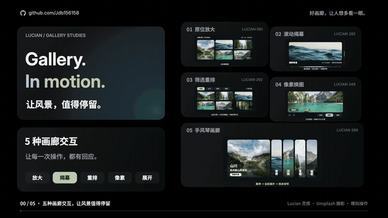

# Gallery. In motion. · 让风景，值得停留。

**[打开交互网页](https://jdb156158.github.io/vibe-photoAlvie/) · [观看完整视频](https://jdb156158.github.io/vibe-photoAlvie/#film) · [下载 MP4](media/gallery-microinteractions-20s.mp4) · [下载影片源码](media/gallery-microinteractions-source.zip)**

## 视频展示

[](https://jdb156158.github.io/vibe-photoAlvie/#film)

20 秒 / 1920×1080 / 60fps。真实摄影、黑色 Bento 布局、GitHub 署名、原创合成配乐与音效。每种控件都包含 **适用场景 + AI 提示词 + 操作演示**，结尾总结 **场景 + 动作 + 反馈**。

## 五种可操作的画廊

| 控件 | 适用场景 | 操作与反馈 |
|---|---|---|
| 原位放大 | 相册详情 | 点击从缩略图放大、关闭归位；双击缩放、拖拽浏览、滑动切图 |
| 滚动揭幕 | 摄影专题 | 上下滚动控制展开进度，标题跟随浮现；反向滚动可还原 |
| 筛选重排 | 作品分类 | 切换全部 / 山川 / 森林 / 海岸，隐藏不匹配项并平滑补位 |
| 像素换图 | 创意轮播 | 切图时像素扩散；支持波浪、圆形、固定种子随机三种方式 |
| 手风琴画廊 | 项目展示 | 悬停、点击或键盘聚焦展开当前面板，其余面板收窄 |

支持触屏、键盘、重置及减少动态效果。视频是模拟操作，网页是使用同一套真实摄影素材与视觉语言的实际交互实现。

## AI 提示词

| 场景 | 可直接复用的短提示词 |
|---|---|
| 相册详情 | 做相册：点击原位放大，关闭缩回。 |
| 摄影专题 | 做滚动画廊：居中展开，标题跟随浮现。 |
| 作品分类 | 做分类图库：筛选缩走，其余平滑补位。 |
| 创意轮播 | 做图片轮播：点击换图，像素从中心扩散。 |
| 项目展示 | 做手风琴画廊：悬停展开，其余收窄。 |

[完整版提示词与整片制作提示词](docs/PROMPTS.md) · [制作步骤](docs/MAKING.md) · [分镜](docs/STORYBOARD.md) · [验收记录](docs/QA.md)

## 本地运行

```sh
python3 -m http.server 4860
```

打开 `http://localhost:4860/`，无需构建。所有照片、字体、脚本均随仓库提供，不依赖在线图片服务。

重新生成视频：

```sh
cd film
npm install
python3 -m pip install numpy
python3 make_audio.py
npm run render
sh encode.sh
```

默认使用 macOS Chrome；其它系统通过 `CHROME_PATH` 指向 Chrome。需要 ffmpeg。更多说明见 [制作步骤](docs/MAKING.md)。

## 文件结构

- `index.html`、`site/`：可交互网页、样式、逻辑与提示词数据。
- `film/`：确定性 Canvas 影片源码、渲染脚本、配乐合成、摄影素材与字体。
- `media/`：MP4、动态预览、海报、总览和影片源码 ZIP。
- `docs/`：提示词、制作步骤、分镜与验收记录。

## 来源

交互灵感：[Lucian UX/UI Prompt](https://lucianlabs.dev/uxui-prompt/)，编号 061、282、292、349、389。布局风格参考：[Guanmo Bento Grid](https://guanmo-ai.github.io/design-style/?lang=zh#work-01-bento-grid)。影片和交互网页为独立重绘实现。

摄影来自 Unsplash，逐张原始链接见 [素材清单](film/assets/photo-sources.json)。分类名称不代表精确拍摄地点；摄影与字体权利归各自权利人。字体许可见 `film/assets/fonts/`。
