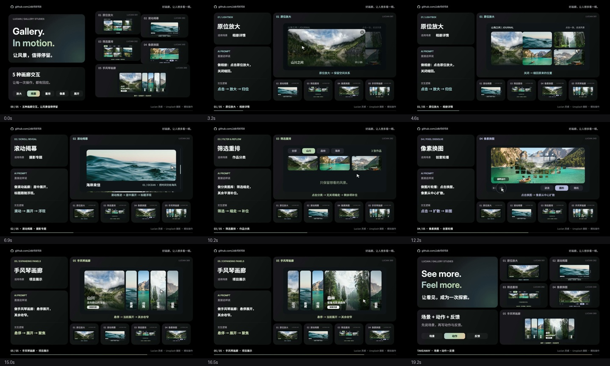

# Gallery. In motion.

20 秒讲清五种真实摄影画廊交互：**原位放大、滚动揭幕、筛选重排、像素换图、手风琴画廊**。每种都有适用场景、短 AI 提示词和操作演示，结尾总结“场景 + 动作 + 反馈”。

1920×1080 · 60fps · H.264 Main + AAC · 原创合成配乐与音效 · 无口播。

[播放视频](../media/gallery-microinteractions-20s.mp4)



- [完整提示词](PROMPTS.md)
- [分镜、节奏与出处](treatment.md)
- [验收记录](QA.md)
- `index.html`：确定性 Canvas 合成，`window.draw(t)`。
- 网站实际交互位于仓库根目录 `site/`；影片为独立 Canvas 重绘。
- `assets/photo-sources.json`：摄影素材地址；`assets/fonts/` 含字体许可。

## 制作步骤

1. 核对 Lucian 061、282、292、349、389 的机制，运行操作前后截图供选择。
2. 用真实摄影替换占位图；筛选分类改为山川、森林、海岸。用户确认后写 `treatment.md`。
3. 先构建像素换图，再沿用 Bento 布局组织五段；每个画面由时间唯一决定，照片与字体均本地加载。
4. 渲染九个关键时刻，第一轮改进开场五项辨识度，第二轮调整高亮标签对比度和关闭归位的停留时间。检查正放、逆向跳转和直接采样的一致性。
5. `make_audio.py` 用固定随机种子合成 120 BPM、2/4 拍配乐：第一拍 0 秒，20 秒为 20 个完整小节。章节切点位于小节线，操作落点有对应音效；18 秒终止和弦后淡出。
6. Playwright 等待 `window.ready`，以每秒 60 帧调用 `draw(t)` 导出 JPG。ffmpeg 合成 H.264/AAC，写入 BT.709、yuv420p、faststart 和每秒关键帧。
7. 最终从 MP4 抽帧，再检查完整播放、跳转、时长、音视频编码与响度，最后打包源码。

## 本地复现

需安装 Node.js、Python 3 + numpy、ffmpeg，以及 Chrome。

```sh
npm install
python3 -m pip install numpy
python3 make_audio.py
npm run stills
npm run render
sh encode.sh
```

默认使用 macOS Chrome 路径，可通过 `CHROME_PATH` 指定本机 Chrome；`FRAME_DIR` 可以指定逐帧目录。渲染源码内 `window.ready` 会等待图片与字体，素材不依赖在线网络。

如已安装 huashu-motion，可用 `om studio . --no-open` 打开编辑预览，`om still . --at 0,3.2,6.9,12.2,19.2` 抽帧。影片音轨以本项目 `make_audio.py` 为准，运行通用 `om sound/render` 会改写音轨；正式制作使用上述逐帧流程。

## 来源说明

交互灵感：[Lucian UX/UI Prompt](https://lucianlabs.dev/uxui-prompt/)；控件编号 061、282、292、349、389。参考原型保留相应控件结构，影片为独立 Canvas 重绘、模拟操作，不声称是原网站录屏。

摄影来自 Unsplash，原始地址逐张记录在 `assets/photo-sources.json`。示例中的“山川、森林、海岸”等为内容分类，不用于声称准确拍摄地点。原始摄影及字体权利归各自权利人。
